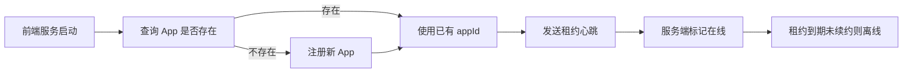
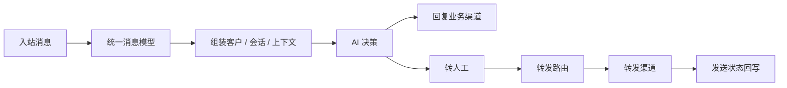

# 聚合客服系统产品规划

> 版本：v0.5  
> 日期：2026-10-14  
> 状态：产品规划草案  

---

## 一、这个产品到底是什么？

这个产品不是先做一个客服前端页面，也不是帮业务方做一个现成的聊天窗口。

它应该是一个**后端客服核心 + 消息转发渠道网关 + 对外 API**。

业务方的网页、App、H5、桌面端、IM 机器人，都可以通过这个产品的对外接口接入。产品负责：

1. 接收消息；
2. 识别客户和会话；
3. 做 AI 判断；
4. 必要时转人工；
5. 把消息转发到指定转发渠道；
6. 记录状态，保证消息不丢、不重复、可追溯。

一句话说：

> 产品做的是客服消息的统一核心和转发网络，各个前端自己接进来。

这里的「渠道」分成两类：

**业务渠道**是消息来源和业务前端。业务方的网页、App、H5、桌面端和自研系统都属于业务渠道。

**转发渠道**是客服核心把消息发出去的后端目标，例如：

- Telegram；
- WhatsApp；
- 飞书；
- 企业微信；
- 钉钉；
- QQ；
- 自研系统；
- 业务方自己的 Webhook / HTTP 接口。

举个例子：

```text
客户从 WhatsApp 业务渠道发消息
       ↓
客服核心收到消息
       ↓
AI 判断 / 规则判断
       ↓
转人工或转发
       ↓
发送到 Telegram / 飞书 / 企业微信等转发渠道
```

所以产品不应该一开始就做一个复杂的前端工作台，而应该先把「客服核心层」「业务渠道接入层」和「转发渠道层」做稳。

---

## 二、产品和前端的边界

### 产品负责

- 对外消息接口；
- 会话模型；
- 客户身份模型；
- AI 决策；
- 知识库；
- 业务渠道和转发渠道配置；
- 消息转发；
- 重试和失败记录；
- 事件 Webhook；
- WebSocket 实时接口；
- 管理配置 API。

### 业务前端负责

- 客服入口 UI；
- 聊天窗口；
- 消息展示；
- 文件选择；
- 会话列表；
- 人工客服自己的操作界面；
- 具体产品形态内的体验。

### 举例

一个业务渠道里的 App 想接客服，可以这样做：

```text
App 前端调用聚合客服 API 创建会话
       ↓
App 把用户消息 POST 给客服系统
       ↓
客服系统返回 AI 回复或进入人工流程
       ↓
如果需要人工，业务前端自己展示处理结果
       ↓
客服系统也可以把消息转发到飞书、企业微信、Telegram 等
```

这意味着产品的第一版本不一定要给业务方一个完整聊天组件。  
产品要给的是一个足够标准、稳定、可扩展的 API 和消息协议。

### 前端形态：Flutter 单端多平台

客户端建议先用 Flutter 做一个可复用端，覆盖：

```text
Android
iOS
H5 / Web
桌面网页
```

原则：

1. **一套 Flutter 代码，多个平台复用。**
2. **移动端输出 Android 和 iOS。**
3. **Web / H5 也走 Flutter Web。**
4. **不做独立桌面客户端。**
5. **桌面浏览器直接使用同一套 Web 页面。**

也就是说，桌面端不是单独的 Flutter Windows / macOS / Linux 目标，而是浏览器访问：

```text
Flutter 项目
├── Android App
├── iOS App
└── Web Build
    ├── H5
    └── Desktop Web
```

这样做的好处是：

1. 原型阶段维护成本最低；
2. 客户演示、坐席值守、管理界面可以共用基础组件；
3. Android / iOS / Web 的消息协议一致；
4. 不需要再维护 Electron、Tauri 或桌面原生端；
5. 桌面侧可以用浏览器快捷方式或 PWA 形态兜底。

如果 Flutter Web 的首屏体积或加载速度成为问题，可以先做两个取舍：

1. H5 / 桌面 Web 用轻量入口页，登录后再加载聊天模块；
2. 客服窗口用独立路由，而不是把完整控制台一次性打进首页。

---

## 三、给谁用？

### 1. 业务开发者

他们是第一批真正接入的人。

他们需要：

- 创建会话；
- 发送消息；
- 查询消息状态；
- 订阅事件；
- 配置业务渠道和转发渠道；
- 接收回调；
- 管理凭据和权限。

### 2. 企业管理员

他们关心：

- 哪些业务渠道已经接入；
- 哪些转发渠道可用；
- AI 是否开启；
- 消息有没有失败；
- 权限和配额怎么控制。

### 3. 运营人员

他们关心：

- AI 应该回答什么；
- 哪些问题要转人工；
- 知识库是否准确；
- 不同转发渠道是否启用 AI。

### 4. 客服系统或业务系统

它可能是业务方的自有客服后台，也可能是已有 IM 工具。

它会调用产品 API：

- 拉取会话；
- 拉取消息；
- 标记已读；
- 认领会话；
- 人工回复；
- 转发到其他转发渠道。

---

## 四、核心模型

### 0. 租户

所有核心资源都属于一个租户。

```text
Tenant
├── tenantId
├── name
├── status
└── settings
```

`App`、`Customer`、`CustomerIdentity`、`Conversation`、`Message`、`MessageDelivery`、`ForwardChannelAccount`、`Webhook` 都必须携带 `tenantId`。  
对外请求不要传 `tenantId`。服务端从 `accessToken` 解析出租户后，在每个查询和写入里强制校验，不允许业务方通过参数跨租户访问。

### 1. 消息

所有消息进入系统后都要变成统一结构。

```ts
type UnifiedMessage = {
  tenantId: string
  messageId: string
  conversationId: string
  customerId: string
  source: {
    appId: string
    clientMessageId?: string
    accountId?: string
    externalId?: string
    providerMessageId?: string
  }
  sender: {
    role: 'customer' | 'agent' | 'ai' | 'system'
    id: string
  }
  type: 'text' | 'image' | 'video' | 'audio' | 'file' | 'event'
  text?: string
  attachments?: Attachment[]
  createdAt: number
  sequence?: number
  status: 'received' | 'queued' | 'sent' | 'delivered' | 'read' | 'failed'
}
```

这里最重要的是：

- 每条消息有全局 ID；
- 第三方消息 ID 单独保存；
- 来源和目标分开；
- 状态可跟踪；
- 内容结构统一。
- 会话内顺序可补齐。

### 2. 会话

一个客户的一次咨询就是一个会话。

```text
Conversation
├── tenantId
├── conversationId
├── customerId
├── appId
├── status
├── assigneeId
└── sequenceCursor
```

常见状态：

| 状态 | 含义 |
| --- | --- |
| `new` | 新会话 |
| `ai` | AI 处理中 |
| `queued` | 等待人工 |
| `open` | 人工处理中 |
| `pending_customer` | 等客户回复 |
| `closed` | 已关闭 |
| `failed` | 系统处理失败 |

状态流转可以是：

```text
new → ai → closed
new → queued → open → closed
ai → queued → open
open → transferred → open
```

### 3. 业务 App 注册与租约

客服核心不应该写死“这个来源一定是某个网页、客户端或 IM 网关”。

更好的方式是把来源抽象成「业务 App」或「业务服务」。一个前端服务上线时，先向客服核心注册，拿到自己的 `appId`，之后通过租约心跳告诉服务端自己仍然在线。

#### 注册模型

```text
App
├── appId
├── tenantId
├── serviceKey          App 唯一标识，例如 web-portal / mobile-app / erp-sync
├── displayName         App 显示名
├── kind                web / h5 / app / desktop / business-system / im-adapter
├── version             当前服务版本
├── callbackUrl         可选，服务端事件回调地址
├── capabilities        支持的能力：text / image / file / webhook
├── status              registered / online / offline / disabled
└── metadata            业务自定义信息
```

这里的 `serviceKey` 是业务侧自己声明的稳定标识，`appId` 是客服核心分配的内部 ID。  
客户身份、消息来源、配置和权限都应该引用 `appId`，不要在核心模型里写死来源类型。

#### 上线流程



#### 心跳租约

App 注册后需要定期续约：

```json
{
  "appId": "app_123",
  "serviceKey": "mobile-app",
  "version": "1.4.2",
  "capabilities": ["text", "image", "file"],
  "ttlSeconds": 60
}
```

服务端记录：

```text
AppLease
├── tenantId
├── appId
├── instanceId
├── lastSeenAt
├── expiresAt
├── ip
├── version
└── metadata
```

心跳的作用：

1. 服务端知道哪些前端服务正在上线；
2. App 异常离线能被发现；
3. 服务实例扩容和重启可观测；
4. 减少人工配置；
5. 支持服务版本和能力动态更新。

手动创建仍然保留。管理员可以在后台预创建一个 App，限制 serviceKey、回调地址和权限，然后前端启动时用这个 serviceKey 匹配。

### 4. 客户身份

一个客户可能有多个来源身份：

- Telegram ID；
- WhatsApp 手机号；
- App 用户 ID；
- 业务系统用户 ID；
- 临时游客 ID。

建议分成两层：

```text
Customer
├── tenantId
├── customerId
├── displayName
└── createdAt
```

每个身份对应一个业务 App：

```text
CustomerIdentity
├── tenantId
├── customerId
├── appId
├── externalId
├── displayName
├── phone
├── email
├── metadata
└── lastSeenAt
```

例如：

```text
Customer
├── CustomerIdentity: tenantId=tenant_001, appId=web-portal, externalId=user_88
├── CustomerIdentity: tenantId=tenant_001, appId=mobile-app, externalId=user_88
└── CustomerIdentity: tenantId=tenant_001, appId=im-gateway, externalId=wa_8613800000000
```

这样客服核心不关心身份来自哪个具体产品，只关心它挂在哪个已注册 App 下。

合并要保守，尤其是没有明确账号关系时，不要自动合并。

---

## 五、业务渠道和转发渠道

为了避免误解，这份文档里的渠道分成两类。

### 1. 业务渠道

业务渠道是消息的来源和业务前端。

它负责：

1. 发起客服消息；
2. 展示客服消息；
3. 接收 AI 回复；
4. 处理人工服务流程；
5. 携带自己的用户身份和业务上下文。

| 业务渠道 | 说明 | 接入方式 |
| --- | --- | --- |
| 自研网页 / H5 | 官网或活动页里的客服入口 | HTTP / WebSocket |
| 自研 App | 产品内置客服入口 | HTTP / WebSocket |
| 桌面客户端 | 产品内客服入口 | HTTP / WebSocket |
| 业务系统 | ERP、CRM、订单系统等 | HTTP / Webhook |
| Telegram 业务入口 | 作为消息来源接入 | Bot API / Webhook |
| WhatsApp 业务入口 | 作为消息来源接入 | WhatsApp API / Webhook |

业务渠道不是产品要帮忙实现的聊天 UI。产品只提供标准接口，由业务前端自己接进来。

业务渠道实例不需要在代码里写死来源类型，而是先注册成一个 App。业务渠道的注册模型复用第 4 节的 `App`：`appId + tenantId + serviceKey + capabilities + leaseStatus`。

| 举例 | 说明 | 接入方式 |
| --- | --- | --- |
| 官网 Web 服务 | 注册为业务 App 后接入 | HTTP / WebSocket |
| 移动端客服服务 | 注册为业务 App 后接入 | HTTP / WebSocket |
| 桌面客户端 | 注册为业务 App 后接入 | HTTP / WebSocket |
| ERP / CRM 同步服务 | 注册为业务 App 后接入 | HTTP / Webhook |
| IM 网关服务 | 把 Telegram / WhatsApp 转成统一 App 消息 | Bot API / Webhook |

### 2. 转发渠道

转发渠道是客服核心把消息发出去的后端目标。

| 转发渠道 | 用途 | 接入方式 |
| --- | --- | --- |
| Telegram | 把客服消息转发给 Telegram 用户或群 | Bot API |
| WhatsApp | 给客户或团队发送 WhatsApp 消息 | WhatsApp API / 会话协议 |
| 飞书 | 内部值班、提醒、人工处理 | 机器人 / Open API |
| 企业微信 | 内部值班、提醒、人工处理 | 机器人 / API |
| 钉钉 | 内部提醒和协作 | 机器人 / API |
| QQ | 特定社群或用户触达 | 机器人 |
| 自研系统 | 把消息回传给业务方 | HTTP / WebSocket / Webhook |
| 通用 Webhook | 把消息送到任何业务系统 | HTTP |

同一个服务可以既是业务渠道，又是转发渠道。  
例如 WhatsApp 可以作为业务渠道接收客户消息，也可以作为转发渠道把结果发给售后群。区别看它在消息流里的角色：

```text
业务渠道：消息从哪里来。
转发渠道：消息要发到哪里去。
```

### 一个典型流程

客户从 WhatsApp 业务渠道发来：

```text
“我的订单没有到账。”
```

系统处理：

1. 识别客户身份；
2. 创建或复用会话；
3. AI 判断这是支付 / 物流问题；
4. 如果知识库能回答，AI 直接回复；
5. 如果不能回答，创建转人工事件；
6. 同时把这条消息转发到企业微信售后群这个转发渠道；
7. 企业微信侧的机器人或业务系统可以继续通过 API 回复；
8. 回复结果再同步回 WhatsApp 业务渠道。

### 转发渠道配置

每个转发渠道实例应该单独配置：

```text
ForwardChannelAccount
├── forwardChannelAccountId
├── tenantId
├── kind: telegram / whatsapp / feishu / webhook
├── displayName: 售后值班群 / 海外客服 / 财务提醒
├── credentials: token / secret / webhook URL
├── capabilities: text / image / file / card
├── status: unconfigured / connected / disconnected
├── policy: AI 回复 / 群聊 / 媒体转发
└── failurePolicy: 重试次数 / 降级转发渠道
```

配置上要能做：

1. 新增转发渠道；
2. 启用 / 停用；
3. 测试发送；
4. 查看最近状态；
5. 查看失败原因；
6. 配置默认转发目标；
7. 配置 AI 是否在这个转发渠道生效。

业务渠道的配置本质上就是 App 配置。可以在 App 配置上扩展用户身份规则、接入方式、能力白名单和租约状态，不再单独引入一套业务渠道账号模型。

---

## 六、对外接口

这是产品最关键的部分。

### 1. 消息接口

这个接口主要给业务渠道和人工处理方使用：

1. 业务前端提交客户消息；
2. 人工客服系统提交回复；
3. 业务系统提交事件消息。

它不是业务前端去“创建一次转发”的接口。  
转发是客服核心内部的异步投递动作，由规则、AI 结果或会话状态触发。

`tenantId` 不要求业务方显式传入，服务端从 `accessToken` 解析后强制注入。

#### 创建消息

```http
POST /api/v1/messages
```

请求示例：

```json
{
  "conversationId": "conv_123",
  "customerId": "cus_456",
  "sender": {
    "role": "customer",
    "id": "wa_8613800000000"
  },
  "source": {
    "appId": "app_im_gateway",
    "externalId": "wamid.xxx"
  },
  "type": "text",
  "text": "我的订单没有到账"
}
```

系统返回：

```json
{
  "messageId": "msg_789",
  "conversationId": "conv_123",
  "status": "received"
}
```

#### 拉取会话消息

```http
GET /api/v1/conversations/{conversationId}/messages
```

#### 更新消息状态

```http
POST /api/v1/messages/{messageId}/status
```

### 2. 会话接口

```http
GET    /api/v1/conversations
POST   /api/v1/conversations
GET    /api/v1/conversations/:id
POST   /api/v1/conversations/:id/assign
POST   /api/v1/conversations/:id/close
POST   /api/v1/conversations/:id/forward
```

### 3. 客户接口

```http
POST /api/v1/customers
GET  /api/v1/customers/:id
POST /api/v1/customers/:id/identities
POST /api/v1/customers/:id/merge
```

### 4. App 注册与租约接口

#### 查询或注册 App

这个接口应该使用租户级 `accessToken`。服务端根据它确定租户和创建人，不允许匿名自动注册。

```http
POST /api/v1/apps/register
```

请求：

```json
{
  "serviceKey": "mobile-app",
  "displayName": "Mobile App",
  "kind": "app",
  "version": "1.4.2",
  "capabilities": ["text", "image", "file"]
}
```

返回：

```json
{
  "appId": "app_123",
  "status": "registered",
  "accessToken": "at_xxx",
  "leaseTtlSeconds": 60
}
```

#### 心跳续约

```http
POST /api/v1/apps/heartbeat
```

请求：

```json
{
  "appId": "app_123",
  "instanceId": "inst_abc",
  "version": "1.4.2",
  "capabilities": ["text", "image", "file"],
  "ttlSeconds": 60
}
```

返回：

```json
{
  "appId": "app_123",
  "leaseStatus": "online",
  "expiresAt": 1790000000
}
```

#### 查询和管理 App

```http
GET  /api/v1/apps
GET  /api/v1/apps/:appId
POST /api/v1/apps/:appId/enable
POST /api/v1/apps/:appId/disable
```

管理后台也可以手动创建 App，适合这些场景：

1. 需要提前控制 `serviceKey`；
2. 需要预分配 `accessToken`；
3. 需要限制回调地址；
4. 需要绑定租户和权限；
5. 需要防止任意服务自动注册。

### 5. 转发渠道接口

```http
GET    /api/v1/channels
POST   /api/v1/channels
PATCH  /api/v1/channels/:id
POST   /api/v1/channels/:id/test
POST   /api/v1/channels/:id/enable
POST   /api/v1/channels/:id/disable
```

### 6. AI 配置接口

```http
GET  /api/v1/ai/config
PUT  /api/v1/ai/config
GET  /api/v1/ai/executions
```

### 7. WebSocket 实时接口

HTTP 接口适合业务前端主动提交消息和拉取历史，但不适合实时接收回复。

如果业务前端需要立刻收到 AI 回复、人工回复、消息状态变化或会话状态变化，就应该提供 WebSocket 接口。

#### 连接

```http
GET /ws/v1/realtime
Upgrade: websocket
Authorization: Bearer <accessToken>
```

也可以用业务渠道自己的鉴权方式：

```http
GET /ws/v1/realtime?appId=app_123&token=xxx
```

连接建立后，客户端可以订阅一个或多个会话：

```json
{
  "type": "subscribe",
  "data": {
    "conversationIds": ["conv_123", "conv_456"]
  }
}
```

也可以取消订阅：

```json
{
  "type": "unsubscribe",
  "data": {
    "conversationIds": ["conv_123"]
  }
}
```

#### 服务端推送事件

```text
message.created
message.updated
message.failed
conversation.updated
conversation.queued
conversation.assigned
conversation.closed
ai.replied
ai.escalated
```

示例：

```json
{
  "event": "message.created",
  "data": {
    "messageId": "msg_789",
    "conversationId": "conv_123",
    "sender": {
      "role": "ai"
    },
    "type": "text",
    "text": "您好，这个问题可以按以下步骤处理。"
  }
}
```

#### 客户端可以发送的消息

WebSocket 不是用来替代所有 HTTP 接口的。建议只用于轻量交互：

```json
{
  "type": "message.send",
  "data": {
    "conversationId": "conv_123",
    "type": "text",
    "text": "我的订单还没有到账"
  }
}
```

```json
{
  "type": "message.status",
  "data": {
    "messageId": "msg_789",
    "status": "read"
  }
}
```

复杂能力仍然走 HTTP：

1. 创建会话；
2. 上传文件；
3. 合并客户；
4. 配置转发渠道；
5. 修改 AI 配置；
6. 拉取历史消息。

#### 可靠性

WebSocket 要考虑断线重连和消息补偿。

断线后客户端应该带上游标重连：

```json
{
  "type": "subscribe",
  "data": {
    "conversationIds": ["conv_123"],
    "lastEventId": "evt_987654"
  }
}
```

服务端应该：

1. 支持心跳；
2. 支持断线重连；
3. 支持事件游标；
4. 短暂断线后能补偿事件；
5. 长时间断线后提示业务方拉取历史；
6. 避免重复推送；
7. 对同一会话保持顺序。

### 8. Webhook 事件

Webhook 适合把客服事件通知给业务后端，例如订单系统、工单系统、内部值班机器人或第三方 CRM。

#### 管理接口

```http
POST   /api/v1/webhooks
GET    /api/v1/webhooks
GET    /api/v1/webhooks/:webhookId
PATCH  /api/v1/webhooks/:webhookId
POST   /api/v1/webhooks/:webhookId/test
POST   /api/v1/webhooks/:webhookId/enable
POST   /api/v1/webhooks/:webhookId/disable
DELETE /api/v1/webhooks/:webhookId
```

创建示例：

```json
{
  "name": "Order System",
  "url": "https://business.example.com/webhooks/customer-service",
  "events": [
    "message.created",
    "message.failed",
    "conversation.created",
    "conversation.queued",
    "conversation.assigned",
    "conversation.closed",
    "ai.replied",
    "ai.escalated"
  ],
  "isActive": true
}
```

返回：

```json
{
  "webhookId": "wh_123",
  "name": "Order System",
  "status": "active",
  "secret": "whsec_xxx"
}
```

#### 推送请求

系统向业务方配置的 URL 发送 `POST`：

```http
POST /webhooks/customer-service
X-Customer-Service-Event: message.created
X-Customer-Service-Delivery: dlv_123
X-Customer-Service-Timestamp: 1790000000
X-Customer-Service-Signature: t=1790000000,v1=...
Content-Type: application/json
```

请求体：

```json
{
  "eventId": "evt_000001",
  "event": "message.created",
  "createdAt": 1790000000,
  "data": {
    "messageId": "msg_789",
    "conversationId": "conv_123",
    "sender": {
      "role": "customer"
    },
    "source": {
      "appId": "app_whatsapp_gateway"
    },
    "type": "text",
    "text": "我的订单没有到账"
  }
}
```

#### 签名验证

签名建议使用：

```text
signedPayload = timestamp + "." + rawBody
signature = HMAC_SHA256(webhookSecret, signedPayload)
```

接收方要校验：

1. 时间戳是否在允许窗口内；
2. 签名是否匹配；
3. `eventId` 是否重复；
4. 事件类型是否已订阅。

#### 重试策略

业务方返回：

```text
2xx：成功
4xx：不再重试或按业务策略处理
5xx：重试
超时：重试
```

建议策略：

1. 首次失败后指数退避；
2. 最多重试 5 到 8 次；
3. 每次重试使用同一个 `eventId`；
4. 接收方按 `eventId` 去重；
5. 最终失败进入死信并产生告警。

#### 与 WebSocket 的关系

WebSocket 适合业务前端实时收消息。  
Webhook 适合业务后端接收事件、触发内部流程或同步到其他系统。

两者可以同时存在，但语义要分开：

| 接口 | 使用方 | 典型场景 |
| --- | --- | --- |
| WebSocket | 业务前端 / 客服前端 | 实时聊天、实时状态 |
| Webhook | 业务后端 | 订单同步、工单创建、CRM 通知 |

业务方可以订阅这些事件：

```text
message.created
message.failed
conversation.created
conversation.queued
conversation.assigned
conversation.closed
ai.replied
ai.escalated
forward_channel.disconnected
```

Webhook 至少要包含：

- 事件类型；
- 事件 ID；
- 会话 ID；
- 消息 ID；
- 业务渠道来源；
- 事件时间；
- 签名；
- 重试机制。

Webhook 事件体不携带 `tenantId`。租户归属由服务端根据 Webhook 订阅关系决定，接收方只依赖 `webhookId`、签名和事件 ID 做校验和去重。

---

## 七、AI 客服层

AI 不是简单调用大模型，而是客服系统里的一个决策器。

它应该输出三态：

| 动作 | 含义 |
| --- | --- |
| `reply` | 直接回复 |
| `ignore` | 不回复 |
| `escalate` | 转人工或转发 |

### 输入

AI 决策前要组装上下文：

1. 客户是谁；
2. 来自哪个来源；
3. 最近几轮消息；
4. 会话标签；
5. 知识库内容；
6. 业务自定义字段；
7. 转发渠道策略。

### 输出

```ts
type AIDecision = {
  action: 'reply' | 'ignore' | 'escalate'
  replyText?: string
  intent?: string
  confidence?: number
  reasonCode?: string
  knowledgeRefs?: string[]
  riskLevel?: 'low' | 'medium' | 'high'
}
```

### 一期规则

1. 常见问题直接回复；
2. 无法判断转人工；
3. 模型异常转人工；
4. 高风险问题不自动回复；
5. 每次决策都保存记录；
6. 支持按转发渠道关闭 AI。

---

## 八、转发机制

### 基本流程



### 转发不是前端再次创建消息

这里要分清两个动作：

```text
创建消息：
业务渠道把客户消息交给客服核心。

转发消息：
客服核心根据规则，把这条消息投递到一个或多个转发渠道。
```

所以业务前端不需要先调 `POST /messages` 创建一条新消息，再去手动触发转发。  
正确流程应该是：

1. 业务渠道 POST 一条入站消息；
2. 客服核心落库；
3. 系统根据规则或 AI 结果生成转发任务；
4. 转发任务进入 Outbox；
5. 渠道适配器把消息投递到 Telegram、飞书、企业微信、Webhook 等；
6. 投递结果回写到 `MessageDelivery`；
7. 失败进入重试或告警。

只有两种情况会由外部主动触发转发：

1. 人工处理方调用 `POST /conversations/:id/forward`；
2. 管理端或业务系统调用后台 API 手动重试。

自动转发永远应该是系统内部事件驱动，不应该由业务前端逐步组装。

### 转发策略

可以按以下条件路由：

| 条件 | 例子 |
| --- | --- |
| 业务渠道 | WhatsApp 来的消息转发到飞书 |
| 客户标签 | VIP 客户转专属群 |
| 会话类型 | 售前、售后、支付异常 |
| AI 结果 | AI 失败转人工 |
| 语言 | 中文转中文客服，英文转英文客服 |
| 工作时间 | 夜间转值班群 |
| 风险等级 | 高风险直接通知负责人 |

### 消息可靠性

转发必须保证：

1. 原始消息先落库，再发送；
2. 每次转发都是一条独立的投递记录；
3. 投递记录包含目标转发渠道、目标账号、外部消息 ID 和状态；
4. 使用 Outbox 模式；
5. 失败可重试；
6. 重试有上限；
7. 最终失败要产生事件；
8. 同一会话内按顺序处理。

一条入站消息可能产生多条投递记录，例如同时发到飞书和企业微信：

```text
Message
├── MessageDelivery → Feishu
├── MessageDelivery → WeCom
└── MessageDelivery → Webhook
```

### 建议引入传统 IM 的可靠消息机制

我们应该直接采用这套机制，而不是把它当成后续优化。

#### 1. 消息和投递分开

消息本体只存一份，投递记录可以有多条。

```text
Message
├── MessageDelivery → Feishu
├── MessageDelivery → WeCom
└── MessageDelivery → Webhook
```

`MessageDelivery` 至少包含：

| 字段 | 说明 |
| --- | --- |
| `tenantId` | 租户 ID |
| `deliveryId` | 投递记录 ID |
| `messageId` | 原始消息 ID |
| `forwardChannelAccountId` | 转发渠道账号 ID |
| `targetId` | 群 ID、用户 ID 或 Webhook 标识 |
| `providerMessageId` | 第三方转发渠道返回的消息 ID |
| `status` | 投递状态 |
| `retryCount` | 重试次数 |
| `nextRetryAt` | 下次重试时间 |
| `failReason` | 失败原因 |

#### 2. 投递状态机

每条 `MessageDelivery` 应该有独立状态：

```text
pending → sending → sent → delivered → read
                  ↘ failed
failed → retrying → sent
failed → dead_letter
```

不要把所有渠道的成功失败都写在 `Message.status` 上。  
`Message.status` 可以表示“客服核心里的消息状态”，`MessageDelivery.status` 表示“每个转发渠道的投递状态”。

#### 3. 会话内顺序

每个会话要有单调递增的 `sequence`。

```text
conversation_123
├── seq=101
├── seq=102
└── seq=103
```

它的作用：

1. 保证客户端展示顺序；
2. 判断消息是否缺失；
3. 支持断线后按序号补拉；
4. 避免不同来源消息乱序。

#### 4. 事件游标

WebSocket 和 Webhook 都应该有 `eventId` 或 `cursor`。

```text
evt_000001
evt_000002
evt_000003
```

客户端断线重连时带上最后一次成功的游标：

```json
{
  "type": "subscribe",
  "data": {
    "conversationIds": ["conv_123"],
    "lastEventId": "evt_000002"
  }
}
```

服务端从这个游标后面继续推送或提示客户端补拉。

#### 5. ACK 和重推

WebSocket 收到事件后，客户端要回 ACK：

```json
{
  "type": "ack",
  "data": {
    "eventId": "evt_000003"
  }
}
```

服务端规则：

1. 没有收到 ACK 就保留事件；
2. 短时间重推；
3. 重推要带幂等键；
4. 客户端根据 `eventId` 去重；
5. 长时间未确认转为离线补偿。

#### 6. 幂等键

至少要支持三类幂等：

| 场景 | 幂等键 |
| --- | --- |
| 业务渠道提交消息 | `tenant_id + app_id + source.clientMessageId` |
| 第三方入站消息 | `tenant_id + forward_channel_account_id + source.providerMessageId` |
| 投递重试 | `delivery_id + attempt_number` |

#### 7. 一期必须落地的最小版本

一期不用做完整分布式消息队列，但下面这些必须有：

1. `Message` 和 `MessageDelivery` 分表；
2. 会话内 `sequence`；
3. 投递状态机；
4. Outbox；
5. 重试次数和下次重试时间；
6. `providerMessageId`；
7. 幂等键；
8. 基础事件游标。

这样后面扩展 WebSocket、Webhook、更多转发渠道时，才不会把消息可靠性重做一遍。

---

## 九、第一期应该做什么？

第一期不要做复杂前端，也不要一次接十类业务渠道或转发渠道。

只做一条最小闭环：

```text
业务渠道 POST 消息 → 系统创建会话 → AI 判断 → AI 回复或转人工 → 消息转发到指定转发渠道 → 状态回传
```

### 第一期功能

#### 核心 API

1. 创建客户；
2. 创建会话；
3. 发送消息；
4. 拉取会话消息；
5. 更新消息状态；
6. 关闭会话；
7. 查询会话状态；
8. WebSocket 实时订阅。

#### 业务渠道与转发渠道

先支持：

1. 通用 API 业务渠道；
2. Telegram 业务入口；
3. WhatsApp 业务入口；
4. Telegram / WhatsApp / Webhook 转发渠道；
5. 飞书或企业微信转发渠道。

#### AI

1. 知识库问答；
2. AI 回复；
3. AI 忽略；
4. 转人工；
5. AI 执行记录。

#### 转发

1. 指定默认转发渠道；
2. 按会话状态转发；
3. 支持重试；
4. 支持失败状态；
5. 支持基础事件 Webhook。
6. `MessageDelivery` 独立记录；
7. 会话内 `sequence`；
8. 事件游标和 ACK。

#### 管理配置

1. 业务渠道配置；
2. 转发渠道配置；
3. AI 配置；
4. 知识库配置；
5. 转发规则配置；
6. AccessToken；
7. Webhook 配置。

### 第一期不做

- 完整客服工作台；
- 复杂聊天组件；
- 语音视频；
- 完整工单系统；
- 大规模报表；
- 多语言；
- 多租户计费；
- 复杂自动化流程。

---

## 十、路线图

### Phase 0：核心验证，2 周

目标：

> 证明一个消息可以从业务渠道进入，经过 AI，再转发到 Telegram 或飞书这类转发渠道。

做四件事：

1. 定义统一消息模型；
2. 提供消息接收 API；
3. 接入 Telegram 业务入口；
4. 接入通用 Webhook 转发渠道。

验收：

1. POST 一条 WhatsApp 文本消息；
2. AI 根据知识库生成回复；
3. 回复能发送到目标转发渠道；
4. 转发状态能记录成功或失败。

### Phase 1：MVP，6 周

目标：

> 业务方可以通过 API 接入业务渠道，并完成 AI 回复、转人工和转发渠道投递。

#### 第 1 到第 2 周：核心消息层

1. 会话模型；
2. 消息模型；
3. 客户模型；
4. AccessToken；
5. 消息接口；
6. WebSocket 实时接口；
7. Webhook；
8. 幂等与重试。

#### 第 3 到第 4 周：AI 层

1. 知识库；
2. AI 三态决策；
3. AI 执行日志；
4. 高风险转人工；
5. 按转发渠道开关 AI。

#### 第 5 到第 6 周：转发渠道层

1. Telegram 转发渠道；
2. WhatsApp 转发渠道；
3. 飞书或企业微信转发渠道；
4. 通用 Webhook 转发渠道；
5. 转发渠道状态；
6. 转发规则；
7. 管理配置接口。

### Phase 2：增强，6 周

重点：

1. 更多业务渠道和转发渠道；
2. 媒体消息；
3. 引用回复；
4. 客户身份合并；
5. 路由规则；
6. 工作时间；
7. SLA；
8. 权限体系；
9. 更完整 Webhook。

### Phase 3：规模化，8 周

重点：

1. 多租户；
2. 配额；
3. 计费；
4. 数据报表；
5. AI 质检；
6. 知识库优化；
7. 审计；
8. 高可用部署。

---

## 十一、关键风险

### 1. API 不稳定

业务方接的是接口，如果接口经常变化，前端会很难受。

应对：

1. API 版本化；
2. 字段向后兼容；
3. 错误码统一；
4. 提供清晰文档；
5. 提供 sandbox 环境。

### 2. 转发渠道协议差异

不同转发渠道对图片、文件、卡片、长度限制支持不同。

应对：

1. 统一消息模型；
2. 每个转发渠道维护能力矩阵；
3. 不支持就降级；
4. 降级规则要记录。

### 3. 消息丢失

这是客服系统最不能接受的问题。

应对：

1. 消息幂等；
2. 先落库；
3. Outbox；
4. 重试；
5. 状态可查；
6. 失败事件。

### 4. AI 回答错误

尤其是价格、退款、合规问题。

应对：

1. 高风险转人工；
2. 低置信度转人工；
3. 知识库引用；
4. 保存决策记录；
5. 支持人工审核。

### 5. 转发渠道限流和封禁

自动转发太激进可能触发转发渠道的服务限制。

应对：

1. 限流；
2. 队列；
3. 退避重试；
4. 转发渠道独立隔离；
5. 异常告警。

---

## 十二、最重要的建议

1. **先做客服核心，不做大前端。**  
   产品的第一价值是稳定接收、判断、转发和记录消息。

2. **对外 API 是主产品。**  
   业务前端自己接进来，因此接口稳定性比 UI 更重要。

3. **区分业务渠道和转发渠道。**  
   业务渠道是消息来源和业务前端；转发渠道是客服核心把消息发出去的后端目标。

4. **统一消息模型优先。**  
   如果消息、会话、客户模型不稳，后面每加一类渠道都会返工。

5. **AI 一期只做三态。**  
   回复、忽略、转人工，足够支撑主流程。

6. **转发失败必须可见。**  
   每条消息都要能查到状态，失败要知道原因。

7. **不要一开始做完整工作台。**  
   可以先给一个最小调试控制台，但不要把工作台当成 MVP 核心。

---

## 十三、还需要补齐的关键设计

目前文档已经把「业务渠道、转发渠道、消息模型、AI、可靠性」讲清楚了，但从可上线系统角度看，还缺下面这些。

### 1. 租户与权限

一期如果不做多租户计费，也至少要做租户隔离。

所有核心表都应该带：

```text
tenant_id
app_id
forward_channel_account_id
created_by
```

`accessToken` 也要有作用域：

```text
messages:read
messages:write
conversations:read
conversations:write
apps:read
apps:write
channels:read
channels:write
ai:read
ai:write
webhooks:read
webhooks:write
```

否则业务渠道之间容易出现数据越权。

### 2. 文件与媒体存储

文档里已经提到图片、视频、音频、文件，但还缺具体机制。

至少要定义：

1. 上传接口；
2. 临时文件地址；
3. 永久存储地址；
4. 文件大小限制；
5. MIME 类型白名单；
6. 病毒扫描策略；
7. 下载链接有效期；
8. 不同转发渠道的降级规则。

### 3. 错误模型

对外接口需要统一错误码，不能每个接口自己发明一套。

建议至少包含：

| 错误类型 | 说明 |
| --- | --- |
| `INVALID_ARGUMENT` | 参数错误 |
| `UNAUTHENTICATED` | 未登录或 accessToken 无效 |
| `PERMISSION_DENIED` | 权限不足 |
| `NOT_FOUND` | 会话、消息、渠道不存在 |
| `RATE_LIMITED` | 触发限流 |
| `CHANNEL_UNAVAILABLE` | 转发渠道不可用 |
| `AI_UNAVAILABLE` | AI 服务不可用 |
| `AI_LOW_CONFIDENCE` | 置信度过低 |
| `DUPLICATE_MESSAGE` | 消息重复 |
| `INTERNAL_ERROR` | 系统异常 |

返回结构要统一：

```json
{
  "error": {
    "code": "CHANNEL_UNAVAILABLE",
    "message": "Forward channel is temporarily unavailable",
    "details": {
      "channelId": "fc_123",
      "retryable": true
    }
  }
}
```

### 4. 观测与排障

客服系统上线后，最重要的不是功能多，而是能不能快速知道“消息去哪了”。

至少要有：

1. 请求日志；
2. AI 决策日志；
3. 转发投递日志；
4. 渠道连接日志；
5. 重试日志；
6. 失败原因统计；
7. 每个业务渠道和转发渠道的健康页；
8. 按 `messageId`、`conversationId`、`deliveryId` 查询链路。

理想状态是：业务方发来一个 `messageId`，我们能在几分钟内说出这条消息当前卡在哪一步。

### 5. 数据保留与隐私

客服消息里经常有手机号、订单号、截图、身份信息。

至少要定义：

1. 消息保存多久；
2. 附件保存多久；
3. 日志保存多久；
4. AI 执行记录保存多久；
5. 删除客户时消息如何处理；
6. 敏感字段是否脱敏；
7. 哪些角色可以看原文；
8. 是否支持数据导出和删除。

### 6. 会话分配和人工流程

虽然不做大前端，但核心模型里还需要支持：

1. 会话分配给谁；
2. 当前处理人是谁；
3. 是否等待人工认领；
4. 是否转接；
5. 是否多人协作；
6. 人工回复来自哪个系统；
7. 会话关闭原因；
8. 超时未处理状态。

否则“转人工”只会有一个事件，没有办法支撑真实服务流程。

### 7. 会话搜索和标签

客服系统稳定运行后，一定会需要：

1. 按客户搜；
2. 按手机号搜；
3. 按会话 ID 搜；
4. 按消息内容搜；
5. 按状态筛；
6. 按业务渠道筛；
7. 按标签筛；
8. 按时间范围筛。

一期不用做复杂搜索引擎，但数据模型里要预留标签、状态、渠道、时间和创建人字段。

### 8. Webhook 安全

Webhook 不能只是 POST 出去，还要考虑：

1. 签名；
2. 时间戳；
3. 重放保护；
4. IP 白名单；
5. 失败重试；
6. 死信通知；
7. 订阅方禁用；
8. 事件体版本化。

### 9. 配置校验

业务渠道和转发渠道配置都需要校验：

| 检查项 | 例子 |
| --- | --- |
| 凭据是否有效 | Token 能否调用成功 |
| 目标是否存在 | 群 ID、用户 ID 是否存在 |
| 能力是否匹配 | 图片发送到不支持图片的渠道 |
| 长度是否合法 | 文本超过渠道限制 |
| Webhook 是否可达 | URL 是否返回 2xx |
| 权限是否足够 | 机器人是否有所需 scope |

保存配置时最好做一次测试探测，而不是等真实消息失败才发现。

### 10. 基础运营指标

一期不用做 BI，但至少要有：

1. 今日入站消息量；
2. 转发成功数；
3. 转发失败数；
4. AI 回复数；
5. AI 转人工数；
6. 活跃会话数；
7. 关闭会话数；
8. 渠道失败 Top N；
9. 慢接口；
10. 队列积压。

这些指标不是为了给老板看大屏，而是为了判断系统是否健康。

---

## 十四、最终总结

这个产品应该这样理解：

```text
业务前端负责展示和交互。

聚合客服系统负责：
1. 接收消息；
2. 统一模型；
3. AI 决策；
4. 会话管理；
5. 客户身份；
6. 业务渠道接入；
7. 转发渠道投递；
8. 消息状态；
9. 对外 API。
```

第一阶段只做一件事：

```text
消息进得来，判得准，转得出，状态查得到。
```

这条链路稳定之后，再扩展更多业务渠道、更多转发渠道、更复杂的 AI 能力和商业化体系。
